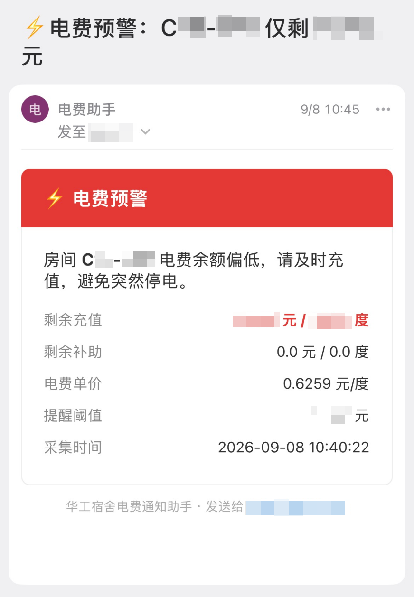
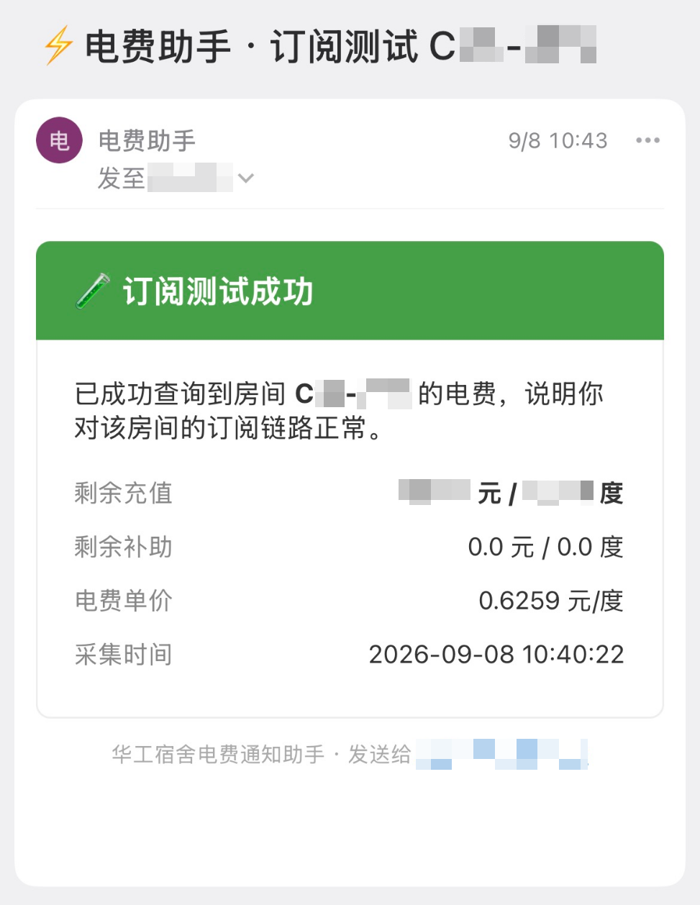

# 华工宿舍电费通知系统

当宿舍电费余额低于阈值时，自动通过**邮件 / 微信推送**提前通知，避免突然停电。
支持按「楼栋 + 房间号」监控任意房间，一份配置可服务多个宿舍/多个用户。

<table>
  <tr>
    <th width="50%">电费预警</th>
    <th width="50%">订阅测试</th>
  </tr>
  <tr>
    <td align="center" valign="top"></td>
    <td align="center" valign="top"></td>
  </tr>
</table>

## 目录结构

```text
ElecfeeNotifySCUT/
├── src/                         # Python、JavaScript 和 Shell 脚本
│   ├── main.py                  # 入口：检查、登录、保活、订阅管理和测试
│   ├── config.py                # 读取运行模式，选择配置和订阅文件
│   ├── scut_client.py           # 会话管理、房间绑定和电费查询
│   ├── scut_login.py            # CAS 登录（依赖本机 node）
│   ├── des.js                   # 登录加密
│   ├── strenc.js                # 加密调用入口
│   ├── resolver.py              # 房间号 → roomId，优先读取本地映射
│   ├── crawl_rooms.py           # 爬取楼栋房间映射（请求间隔 5~6 秒）
│   ├── notifier.py              # 邮件及微信推送
│   ├── probe_session.py         # 探测会话有效期
│   └── run.sh                   # 命令行及 cron 调用入口
├── config/
│   ├── config.example.yaml      # 配置模板，包含 env: dev
│   ├── subscriptions.example.yaml # 订阅表模板
│   ├── config.yaml              # 模式入口：env: dev / prod（本地配置）
│   ├── config_dev.yaml          # 开发业务配置（含密钥，勿提交）
│   ├── config_prods.yaml        # 生产业务配置（含密钥，勿提交）
│   ├── subscriptions_dev.yaml   # 开发订阅表（勿提交）
│   └── subscriptions_prods.yaml # 生产订阅表（勿提交）
├── email_page/                  # 预警、测试、订阅测试和会话失效邮件模板
├── csv/                         # 批量导入及批量测试的 CSV 示例
├── json/                        # 本地数据，勿提交
│   ├── rooms_map.json           # 预爬房间映射（全 28 栋 6502 间）
│   ├── rooms_cache.json         # 房间接口缓存
│   └── state.json               # 余额、通知时间及冷却状态
├── log/                         # run.log、keepalive.log、probe.log 等日志
├── tests/
│   └── test_config.py           # 配置选择和会话写回测试
├── requirements.txt             # Python 依赖
├── README.md
└── LICENSE
```


## 安装

```bash
pip install -r requirements.txt
cp config/config.example.yaml config/config.yaml      # 模式入口，默认 dev
cp config/config.example.yaml config/config_dev.yaml  # 填写开发业务配置
cp config/subscriptions.example.yaml config/subscriptions_dev.yaml # 填写开发订阅表
# 生产部署：业务配置和订阅表分别复制为 config_prods.yaml、subscriptions_prods.yaml
# 并将 config/config.yaml 的 env 改为 prod
# 已有配置文件请直接编辑，不要用复制命令覆盖
```

## 配置

所有含敏感信息的配置都在 `config/` 目录下（已被 `.gitignore` 忽略）：

- `config/config_prods.yaml`（或 `config_dev.yaml`）：填 `session.jsessionid`、`smtp`、
  默认阈值 `defaults.threshold_money`、查询节流 `check.query_interval` 等。
- `config/subscriptions_prods.yaml`（或 `_dev`）：订阅表（用命令管理，见下）。
- `config/config.example.yaml`：配置模板，包含默认模式 `env: dev`。
- `config/subscriptions.example.yaml`：订阅表模板，复制后填写自己的房间、邮箱和阈值。
- `config/config.yaml`：通过 `env` 切换当前模式：

  ```yaml
  env: prod  # 开发环境填写 dev
  ```

  启动先读取此文件，再按模式加载业务配置和订阅表；这里的其他字段不参与业务配置合并。
  `dev` 对应 `config_dev.yaml` / `subscriptions_dev.yaml`，
  `prod` 对应 `config_prods.yaml` / `subscriptions_prods.yaml`（保留原有命名）。
  不再读取 `ELECFEE_ENV`，无需在终端或 cron 中设置它。
  入口、`env` 或业务配置缺失/无效时明确报错退出，不会自动切回开发模式。
  订阅文件不存在时仍按空订阅处理，新增订阅时创建对应模式的文件。
  启动日志显示实际模式和文件路径；登录、保活、检查、订阅管理及会话探测使用同一模式。

### 半自动登录 `--login`

```bash
python3 src/main.py --login
```

## 使用

```bash
python3 src/main.py --check-room C1 101              # 临时查某房间余额（不发通知）
python3 src/main.py --dry-run                        # 跑一轮但不真正发通知
python3 src/main.py --once                           # 正式跑一轮（供 cron 调用）
python3 src/main.py --login                          # 交互式登录，刷新会话（见上）
python3 src/main.py --keepalive                      # 会话保活（供 cron 每~20分钟调用）
python3 src/main.py --test-email x@example.com       # 发测试邮件（省略则发给管理员邮箱）
python3 src/main.py --test-sub C1-101 x@example.com  # 测试订阅：查询并发送测试邮件
python3 src/main.py --test-csv csv/test.example.csv  # 批量测试：CSV逐行发订阅测试邮件
python3 src/main.py --add-sub C1-101 a@example.com 10 # 新增订阅：房间号 邮箱 阈值(元)
python3 src/main.py --import-csv csv/subscriptions.example.csv # CSV 批量导入订阅
python3 src/main.py --remove-sub C1-101 a@example.com # 删除某人对该房间的订阅
python3 src/main.py --remove-sub C1-101              # 删除该房间的全部订阅
python3 src/main.py --list-subs                      # 列出所有订阅
```

也可通过 `src/run.sh` 带参数执行相同命令，例如 `./src/run.sh --add-sub C1-101 a@example.com 10`。

## 订阅（面向多用户，每人独立阈值）

订阅按「房间 -> 多个 (邮箱, 阈值)」组织：同一房间可以有多个订阅者，**每人可设不同的最低通知阈值(元)**。
推荐用命令管理（会写入当前模式对应的 `subscriptions_dev.yaml` 或 `subscriptions_prods.yaml`）：

```bash
python3 src/main.py --add-sub C1-101 alice@example.com 10 # Alice：余额<10元 提醒
python3 src/main.py --add-sub C1-101 bob@example.com 5    # Bob：余额<5元 才提醒
python3 src/main.py --remove-sub C1-101 bob@example.com   # 删 Bob 一条
python3 src/main.py --remove-sub C1-101                   # 删该房间的全部订阅
python3 src/main.py --list-subs
```

订阅表结构（可手动编辑）：

```yaml
C1-101:
- email: alice@example.com
  threshold: 10.0
- email: bob@example.com
  threshold: 5.0
```

- 房间号是完整名（含楼栋，如 `C1-101`），新增时会校验房间是否存在。
- 每个订阅者**独立判断**是否低于自己的阈值，**独立冷却**（按 房间+邮箱 计，`cooldown_hours` 内不重复），
  且**各自单独收到一封邮件**（含自己的阈值、互相看不到邮箱）。
- 解析房间时优先查 `json/rooms_map.json`（见下），查不到则实时解析。
- **会话过期提醒**：当 JSESSIONID 失效时，给 `check.session_alert_email`
  （默认填写的管理员邮箱）发“请重新登录”邮件（12 小时内不重复）。

### 批量导入 `--import-csv`

准备一个 CSV（3 列：**房间号, 邮箱, 阈值**，可带表头，兼容 UTF-8/GBK）：

```csv
房间号,邮箱,阈值
C1-101,alice@example.com,10
C1-101,bob@example.com,5
C1-101,dave@example.com,15
```

```bash
python3 src/main.py --import-csv csv/subscriptions.example.csv
```

- 幂等：同一邮箱重复导入是**更新阈值**，不会重复添加；
- 逐行校验房间号，不存在的会计入“失败”并列出行号，其余照常导入；
- 自动跳过表头/空行。参考 `csv/subscriptions.example.csv`。

### 批量测试 `--test-csv`

用一个 CSV逐行发“订阅测试”邮件，
**每两次之间随机间隔**（默认 5~15 秒，可配 `check.test_interval`）：

```bash
python3 src/main.py --test-csv csv/test.example.csv
```

用来一次性验证多个订阅者的「房间解析→查询→发到邮箱」链路。参考 `csv/test.example.csv`。

## 邮件模板 `email_page/`

所有邮件正文都是 `email_page/` 下的 HTML 模板，可自由编辑样式与文案：

| 模板 | 用途 |
|---|---|
| `alert.html` | 电费预警 |
| `test.html` | `--test-email` 测试邮件 |
| `test_sub.html` | `--test-sub` / `--test-csv` 订阅测试 |
| `session_expired.html` | 会话失效提醒 |

- 用 `{{变量}}` 占位，例如 `{{room_name}}`、`{{left_money}}`、`{{left_ele}}`、`{{ele_price}}`、
  `{{threshold}}`、`{{mon_time}}`、`{{email}}`、`{{now}}`（每个模板顶部注释列了可用变量）。
- 用 `<!-- subject: 标题{{变量}} -->` 定义邮件标题。

## 时区

所有时间（日志、邮件里的采集时间/当前时间）统一按**北京时间 `Asia/Shanghai`** 显示，
即使服务器在 UTC 时区也不会差 8 小时（程序启动时设 `TZ` + `tzset()` 强制）。
如需改时区设环境变量 `ELECFEE_TZ`。

### 预爬房间表 `src/crawl_rooms.py`

把楼栋内所有房间的 `roomId` 爬到 `json/rooms_map.json`，解析更快更稳（请求间随机间隔 5~6 秒）：

```bash
python3 src/crawl_rooms.py                # 默认爬 C1
python3 src/crawl_rooms.py C1 C2 C3       # 爬指定楼栋（增量合并）
python3 src/crawl_rooms.py --all          # 爬城校区所有楼栋（已内置全 28 栋 6502 间）
python3 src/crawl_rooms.py --list         # 只列出所有楼栋名
```

## 定时运行（macOS / Linux cron）

因为会话（JSESSIONID）约 30~35 分钟空闲就失效，所以用**每 20 分钟一次的保活**把会话续命，
再加**每天一次的检查**。示例 crontab（路径/解释器按实际调整）：

```cron
CRON_TZ=Asia/Shanghai
# 每 20 分钟保活（错峰在 7/27/47 分），保证会话不因空闲而过期
7,27,47 * * * * cd /path/to/ElecfeeNotifySCUT && /path/to/python src/main.py --keepalive >> log/keepalive.log 2>&1
# 每天 8:13(北京时间) 检查一次电费并按订阅发通知
13 8 * * * cd /path/to/ElecfeeNotifySCUT && /path/to/python src/main.py --once >> log/run.log 2>&1
```

> `CRON_TZ=Asia/Shanghai` 让上面的时间按北京时间解释（Linux/Vixie cron 通用）。
> 订阅房间较多时，一轮检查耗时 ≈ 房间数 × `check.query_interval`（默认 5~6 秒/房间，串行），
> 注意让单轮耗时短于保活间隔。

- 保活只读 `userinfo`、不改绑定房间；一旦会话真失效（服务器重启/绝对上限），保活或检查会
  检测到并给 `check.session_alert_email` 发提醒，此时手动 `python3 src/main.py --login` 即可。
- 日志：保活写 `log/keepalive.log`，每日检查写 `log/run.log`。

## 日志与轮转（logging + logrotate）

程序内部统一用 Python 标准 `logging`，格式为 `[时间] 级别 内容`（时间是北京时间）：

```
[2026-09-10 14:38:26] INFO 会话有效，账号：xxx (xxxxxxxxxxxx)
```

**日志只写到 stdout，程序自身不写文件、也不做切割**——落盘完全靠上面 crontab 里的
`>> log/xxx.log 2>&1` 重定向，日志轮转交给操作系统的 `logrotate` 处理，各司其职。

因为每次 cron 调用都是新开文件句柄追加、跑完即关（进程不长期持有文件），所以 logrotate
用默认的「重命名 + 新建」即可，**不需要** `copytruncate`。在服务器上（需 root）：

```bash
sudo vim /etc/logrotate.d/elecfee
```

填入：

```
/path/to/ElecfeeNotifySCUT/log/*.log {
    daily                # 每天轮转一次
    rotate 14            # 保留 14 份历史
    missingok            # 文件不存在不报错
    notifempty           # 空文件不轮转
    compress             # 旧日志 gzip 压缩
    delaycompress        # 上一份延迟到下次轮转再压缩，避免和正在写的冲突
    dateext              # 轮转文件名带日期后缀，如 run.log-20260910
    su youruser yourgroup   # 以该用户/组身份操作日志目录
    create 0644 youruser yourgroup  # 轮转后新建同权限的空日志
}
```

验证与手动触发：

```bash
sudo logrotate -d /etc/logrotate.d/elecfee    # dry-run，只打印计划、不实际执行
sudo logrotate -fv /etc/logrotate.d/elecfee   # 强制跑一次，确认能正常切割
```

系统自带的 `cron.daily` 每天会自动调用 `logrotate`，配置放进 `/etc/logrotate.d/` 即生效，无需额外定时任务。

## 可动态修改的项

- 订阅：`--add-sub` / `--import-csv` / `--remove-sub`(整房间或单条) / `--list-subs`。
- 默认阈值（订阅未指定阈值时用）：`config` 的 `defaults.threshold_money`。
- 检查频率：改 crontab 的时间表达式。
- 冷却期：`config` 的 `check.cooldown_hours`（`0` = 关闭，测试用）。
- 房间间查询节流：`config` 的 `check.query_interval`（数字或 `[min,max]`）。
- 批量测试间隔：`config` 的 `check.test_interval`（数字或 `[min,max]`）。
- 会话过期提醒邮箱：`config` 的 `check.session_alert_email`。
- 邮件样式/文案：`email_page/*.html`。
- 时区：环境变量 `ELECFEE_TZ`（默认 `Asia/Shanghai`）。

# 使用声明

本项目仅供学习、技术交流及个人研究使用，旨在帮助开发者了解相关接口调用、自动化任务及通知机制的实现方式。

使用者在下载、部署、修改或使用本项目时，应自行确保其使用行为符合所在国家或地区的法律法规，以及相关平台、学校或服务提供方的管理规定。请勿将本项目用于任何未经授权的数据获取、隐私侵犯、恶意访问、牟利性滥用或其他违法违规用途。

本项目不会主动收集、存储或传播与其正常功能无关的个人信息。使用者应妥善保管自身账号、凭据及配置文件，不得利用本项目访问、查询或处理其无权获取的信息。

开发者不对使用者因不当使用、违规操作、配置错误、第三方服务变更、接口调整或其他非项目本身可控因素造成的直接或间接损失承担责任。任何基于本项目进行的二次开发、部署和实际使用行为，均由使用者自行判断并承担相应责任。

如相关组织、平台或权利方认为本项目存在不适当内容或潜在风险，欢迎通过项目 Issue 等方式联系开发者处理。
